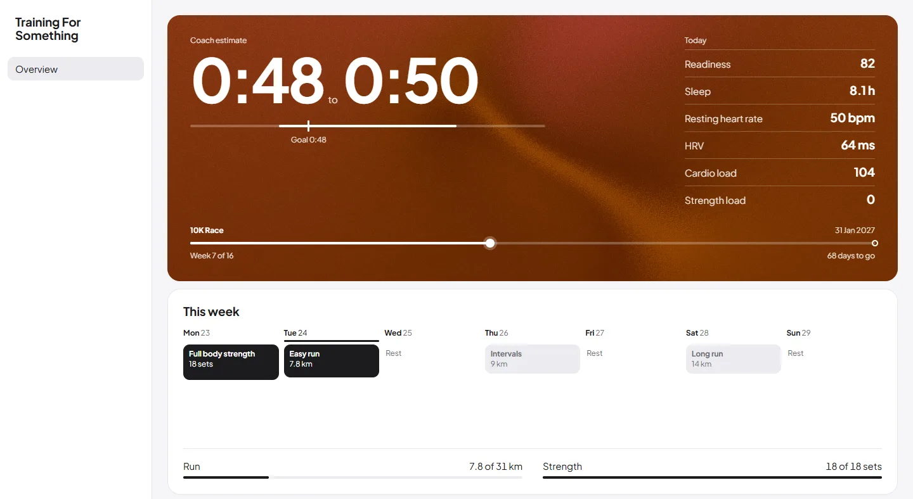
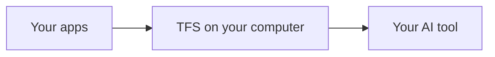

# Training For Something

A free, open source coach for your goal. It runs on your computer, reads your health and training apps, and answers your questions through the AI tool you already use.

[Install](#install) · [Releases](https://github.com/PrabhjotSodhi/training-for-something/releases) · [License](#license)

[](https://github.com/PrabhjotSodhi/training-for-something/actions/workflows/tests.yml)
[](LICENSE)
[](https://github.com/PrabhjotSodhi/training-for-something/releases)



## Features

Now:

- One line installs TFS. A guided setup connects your AI tools and apps.
- Brings in your workouts, sleep and health data, and counts each workout once.
- Shows your goal, your week, your sleep and your trends on a dashboard that runs on your computer.
- Answers questions about your data in Claude Code or Codex.
- Plans changes to your training in chat. You see every change before it saves.
- Keeps all your data in one folder on your computer.

Coming soon:

- Missed a session? Your coach reviews the rest of your week and has a new plan waiting for your OK.
- Your coach works in the background, so you don't have to open a chat.
- A daily effort load from your workout ratings, shown against your own normal.
- Plans sent straight to Hevy as routines.
- Log food with a photo, and read lab results from a PDF.
- Android phones through Health Connect, and Fitbit through Apple Health.

## Install

You need Claude Code or Codex. One line installs TFS and starts setup.

Mac and Linux:

```sh
curl -fsSL https://raw.githubusercontent.com/PrabhjotSodhi/training-for-something/main/install.sh | sh
```

Windows, in PowerShell:

```powershell
curl.exe -fsSLo install.ps1 https://raw.githubusercontent.com/PrabhjotSodhi/training-for-something/main/install.ps1; powershell -ExecutionPolicy ByPass -File install.ps1; del install.ps1
```

Setup connects your AI tools and your apps, then opens the dashboard. Run the same line again to update.

## Works with

| AI tools | Apps |
|---|---|
| Claude Code | Apple Health export |
| Codex | Health Auto Export |
| | Hevy |

## How it works



Plain code stores your data, counts each workout once and builds daily totals. Your AI tool reads those numbers through the local TFS tool. Your data goes only to the apps you connect and the AI tool you choose.

Read more in the [high level design](docs/HLD.md), the [code map](docs/code-map.md) and the [specs](docs/specs/).

## Plan changes in chat

Ask for a change, like "Limit my sessions to 45 minutes and add an easy run tomorrow." TFS shows the exact changes and the reason for each. Nothing saves until you approve it in your AI tool's permission prompt. Sending plans to your connected apps is still being built.

Keep the `save` tool set to ask for permission. An always allow setting skips that prompt. Your AI tool runs with your computer's permissions, so TFS cannot stop it from writing a change you refused through another route.

## Not medical advice

Training For Something gives no medical advice, diagnoses or doses, and never changes a clinician's targets. Its answers are not a substitute for a doctor or physio. If something feels like an emergency, call your local emergency number.

## Set up by hand

Skip this if you ran `tfs setup`.

1. Install the wheel from the newest [release](https://github.com/PrabhjotSodhi/training-for-something/releases): `uv tool install --force <wheel URL>`
2. Add the plugin to Claude Code:
   ```sh
   claude plugin marketplace add PrabhjotSodhi/training-for-something
   claude plugin install tfs@training-for-something
   ```
3. Or add it to Codex:
   ```sh
   codex plugin marketplace add PrabhjotSodhi/training-for-something
   codex plugin add tfs@training-for-something
   ```
4. Import your data, for example `tfs import export.zip` for an Apple Health export.
5. Run `tfs start` to open the dashboard.

If your terminal cannot find `tfs`, run `uv tool update-shell` and open a new terminal.

## From source

```sh
npm --prefix dashboard install && npm --prefix dashboard run build && uv tool install --editable .
```

## Contributing

Work is planned as GitHub issues, grouped by milestone. Read [AGENTS.md](AGENTS.md) before you open a pull request.

## License

TFS is free software under the [GNU Affero General Public License v3.0 or later](LICENSE). You may use, change and share it. If you share a changed version, or run one as a service for others, you must publish your source code under the same license.

The license covers the code only. It gives no right to use the Training For Something name or logo.
