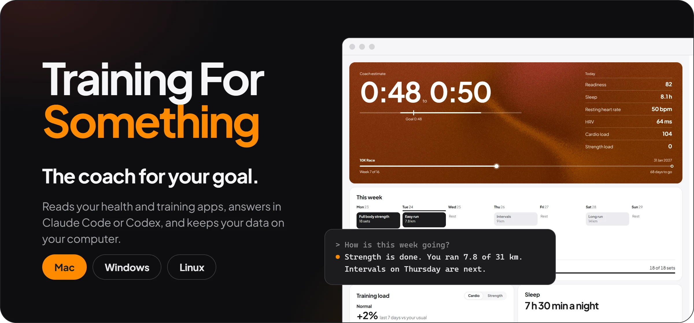
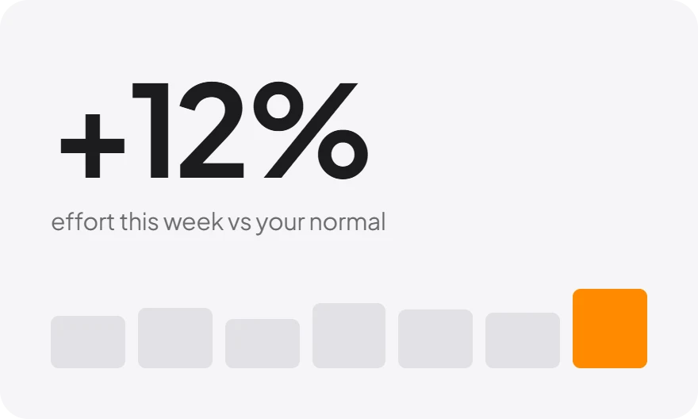
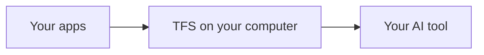

<div align="center">



**A free, open source coach for your goal.**

It runs on your computer, reads your health and training apps,<br>
and answers your questions through the AI tool you already use.

[](https://github.com/PrabhjotSodhi/training-for-something/actions/workflows/tests.yml)
[](LICENSE)
[](https://github.com/PrabhjotSodhi/training-for-something/releases)

[Install](#install) · [Releases](https://github.com/PrabhjotSodhi/training-for-something/releases) · [License](#license)

</div>

## Know where you stand every morning

- Fall behind and your coach adjusts the plan. You ask in chat and approve the change.
- A recovery score from your HRV, resting heart rate and sleep, against your own normal.
- How much sleep you need tonight. `Coming soon` Today the sleep card shows your nights against a target.
- Food from a photo, with protein, carbs and fat. `Coming soon`
- Lab results over time. `Coming soon`

## Features

<table>
<tr>
<td width="50%" valign="top"><br><b>Know where you stand</b><br>See your forecast for your goal and your week at a glance. The dashboard runs on your computer.</td>
<td width="50%" valign="top"><br><b>Ask anything</b><br>Ask in your AI tool. Answers come from your own data and the research.</td>
</tr>
<tr>
<td width="50%" valign="top"><br><b>A plan that updates</b><br>Say yes and your coach saves the change. Nothing changes without your yes.</td>
<td width="50%" valign="top"><br><b>Your plan in Hevy</b><br>Today's strength session waits for you in Hevy. Sending plans to Garmin <code>Coming soon</code></td>
</tr>
<tr>
<td width="50%" valign="top"><b>Train the right muscles</b><br>See your sets by muscle each week. Ask your coach how your lean mass and waist are changing.</td>
<td width="50%" valign="top"><br><b>Runs on the AI subscription you already pay for</b><br>Pick from 9 AI tools, including Claude Code and Codex.</td>
</tr>
<tr>
<td width="50%" valign="top"><br><b>A coach in the background</b> <code>Coming soon</code><br>It checks your data each morning, so you do not have to ask.</td>
<td width="50%" valign="top"><br><b>Know how hard your week was</b><br>Your workout ratings against your own normal.</td>
</tr>
</table>

See the [roadmap](ROADMAP.md) for what comes after 0.1.0.

## Install

You need one of the AI tools listed under Works with. One line installs TFS and starts setup.

Mac and Linux:

```sh
curl -fsSL https://raw.githubusercontent.com/PrabhjotSodhi/training-for-something/main/install.sh | sh
```

Windows, in PowerShell:

```powershell
$f = "$env:TEMP\tfs-install-$(Get-Random).ps1"; curl.exe -fsSLo $f https://raw.githubusercontent.com/PrabhjotSodhi/training-for-something/main/install.ps1; if ($?) { powershell -ExecutionPolicy ByPass -File $f }; Remove-Item $f -ErrorAction Ignore
```

Setup connects your AI tools and apps. For Health Auto Export, scan its code on your home Wi-Fi. Turn on both Wi-Fi automations for health metrics and workouts. If you add Tailscale later in setup, scan its separate automation code and turn on both Tailscale automations.

To view TFS on your phone, scan the pairing code on your home Wi-Fi. On Windows, setup asks once for admin approval if the firewall needs a change. Home Wi-Fi traffic is not encrypted, so anyone on the same Wi-Fi network could read it. Add Tailscale to view TFS away from home, with encrypted traffic. Run `tfs phones forget` to remove home Wi-Fi access for all paired phones.

Setup opens the dashboard on your computer. Keep that terminal open while you use TFS. After you stop TFS with Ctrl+C, run `tfs start --open` in a new terminal to reopen it. Run `tfs update` to update.

## Works with

| AI tools | Apps |
|---|---|
| Claude Code (tested) | Apple Health export |
| Codex (tested) | Health Auto Export (Premium) |
| Cursor (should work) | Hevy (Pro and an API key) |
| OpenCode (should work) | Garmin (read only, with a Garmin Connect Personal API key) |
| Grok Build (should work) | |
| Google Antigravity CLI (should work) | |
| Kiro CLI (should work) | |
| Pi (should work) | |
| Meta Muse Code (should work) | |

Windows and macOS are tested. Linux should work but is untested.

TFS works next to other MCP servers in the same AI tool. Strava runs an [official MCP server](https://support.strava.com/en-us/articles/15401531-what-is-the-strava-mcp-connector) for subscribers.

## How it works



Plain code stores your data, counts each workout once and builds daily totals. The same workout from two apps counts once. Your AI tool reads those numbers through the local TFS tool. Your data goes only to the apps you connect and the AI tool you choose.

Read more in the [high level design](docs/HLD.md), the [code map](docs/code-map.md) and the [specs](docs/specs/).

## Plan changes in chat

Ask for a change, like "Limit my sessions to 45 minutes and add an easy run tomorrow." TFS shows the exact changes and the reason for each. Nothing saves until you approve it in your AI tool's permission prompt. Approved strength sessions go to Hevy, into a routine you pick or a new one.

Keep the `save` tool set to ask for permission. An always allow setting skips that prompt. Your AI tool runs with your computer's permissions, so TFS cannot stop it from writing a change you refused through another route.

## Go back to an older version

Before an update changes your database, TFS saves a copy in the `backups` folder of the TFS data folder. It keeps the 2 newest. To go back:

1. Stop TFS with Ctrl+C, and close your AI tools so nothing has the database open.
2. Install the older release: `uv tool install --force <wheel URL>`
3. In the data folder, move `tfs.db`, `tfs.db-wal` and `tfs.db-shm` into a new folder. Moving all three matters: a leftover `tfs.db-wal` can undo the restore.
4. Copy the backup you want into the data folder and name it `tfs.db`.

Data saved after the update is lost.

## Not medical advice

Training For Something gives no medical advice, diagnoses or doses, and never changes a clinician's targets. Its answers are not a substitute for a doctor or physio. If something feels like an emergency, call your local emergency number.

## Set up by hand

Skip this if you ran `tfs setup`.

1. Install the wheel from the newest [release](https://github.com/PrabhjotSodhi/training-for-something/releases): `uv tool install --force <wheel URL>`
2. Add the plugin to Claude Code:
   ```sh
   claude plugin marketplace add PrabhjotSodhi/training-for-something
   claude plugin install tfs@training-for-something
   ```
3. Or add it to Codex:
   ```sh
   codex plugin marketplace add PrabhjotSodhi/training-for-something
   codex plugin add tfs@training-for-something
   ```
4. Import your data, for example `tfs import export.zip` for an Apple Health export.
5. Run `tfs start --open` to open the dashboard.

If your terminal cannot find `tfs`, run `uv tool update-shell` and open a new terminal.

## From source

```sh
npm --prefix dashboard install && npm --prefix dashboard run build && uv tool install --editable .
```

## Contributing

Work is planned as GitHub issues, grouped by milestone. Read [AGENTS.md](AGENTS.md) before you open a pull request.

## License

TFS is free software under the [GNU Affero General Public License v3.0 or later](LICENSE). You may use, change and share it. If you share a changed version, or run one as a service for others, you must publish your source code under the same license.

The license covers the code only. It gives no right to use the Training For Something name or logo.
