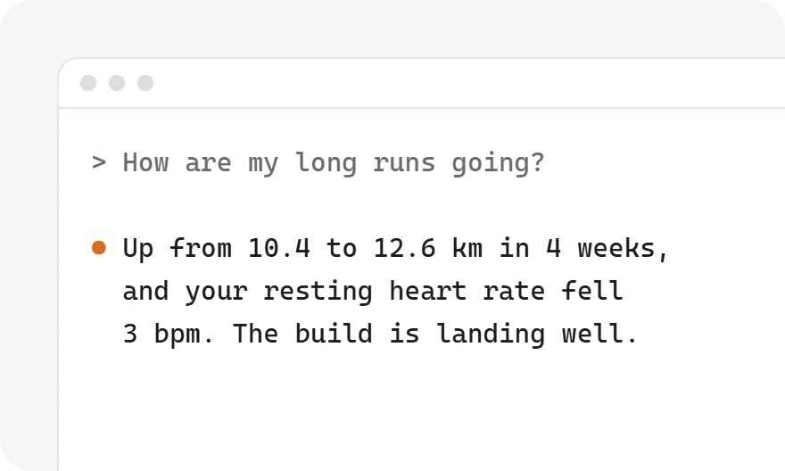
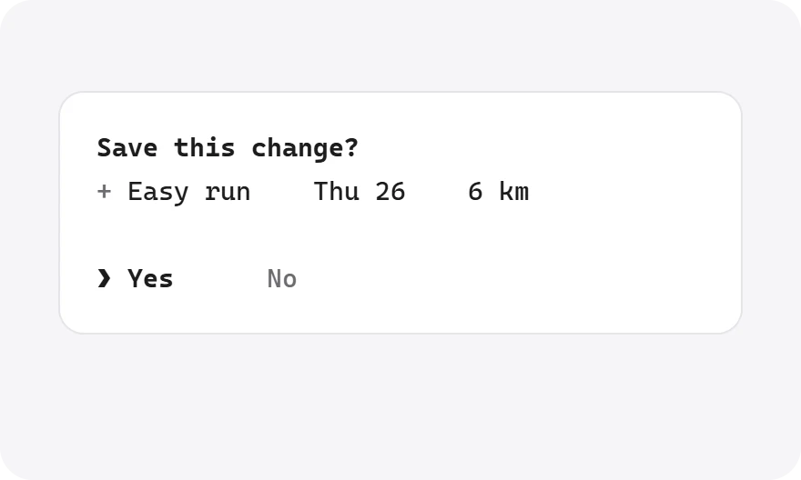
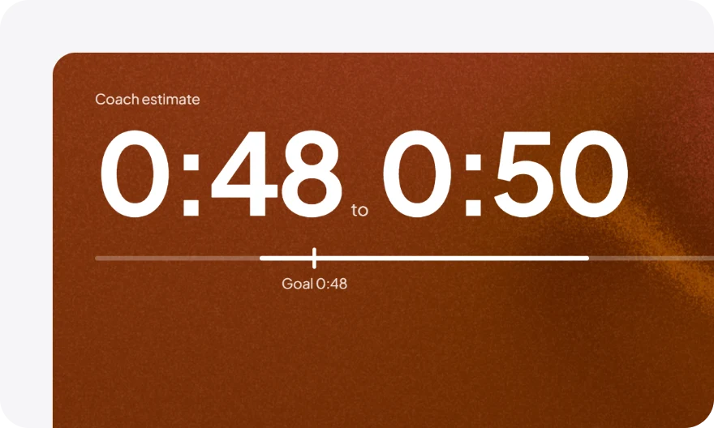
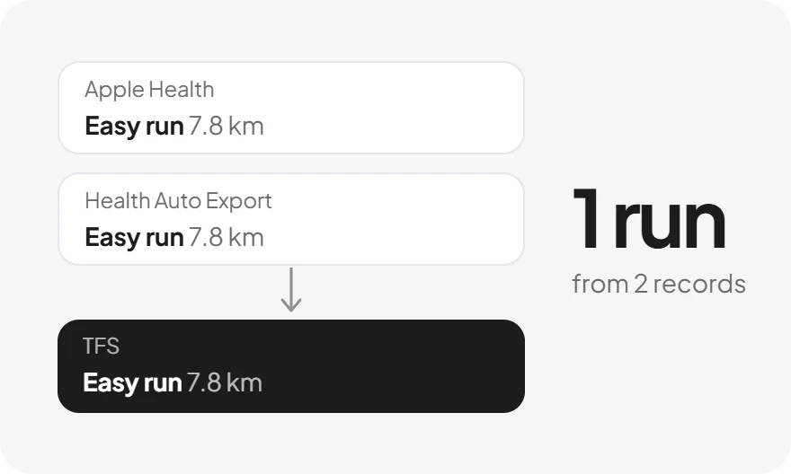
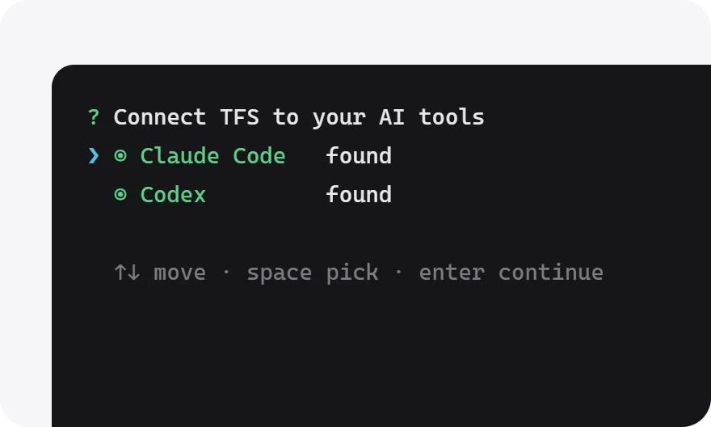
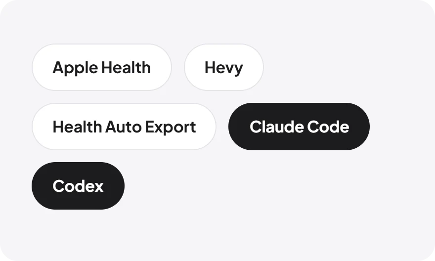
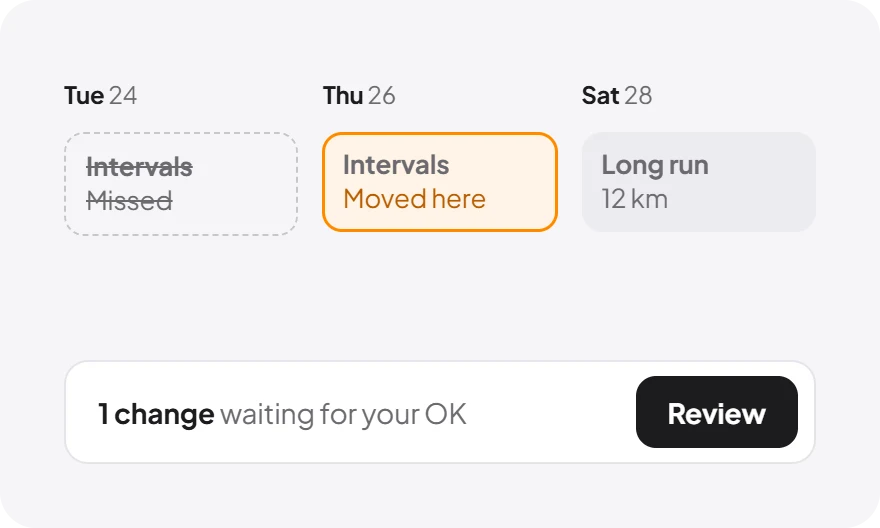
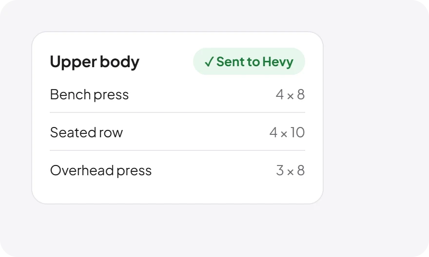
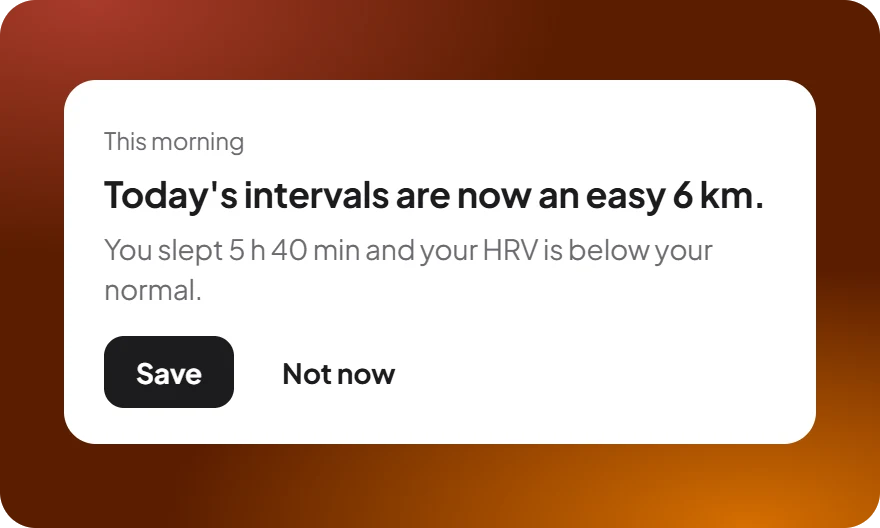
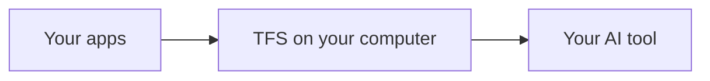

<div align="center">


**A free, open source coach for your goal.**

It runs on your computer, reads your health and training apps,<br>
and answers your questions through the AI tool you already use.

[](https://github.com/PrabhjotSodhi/training-for-something/actions/workflows/tests.yml)
[](LICENSE)
[](https://github.com/PrabhjotSodhi/training-for-something/releases)

[Install](#install) · [Releases](https://github.com/PrabhjotSodhi/training-for-something/releases) · [License](#license)

</div>

## Features

<table>
<tr>
<td width="50%" valign="top"><br><b>Ask your coach</b><br>Ask in Claude Code or Codex. Answers come from your own numbers.</td>
<td width="50%" valign="top"><br><b>Approve every change</b><br>Your coach shows each change first. Nothing saves without your yes.</td>
</tr>
<tr>
<td width="50%" valign="top"><br><b>Your goal, front and centre</b><br>A dashboard on your computer shows your forecast, today and your week.</td>
<td width="50%" valign="top"><br><b>Counted once</b><br>The same run from two apps stays one run.</td>
</tr>
<tr>
<td width="50%" valign="top"><br><b>One line to install</b><br>Setup finds your AI tools and connects your apps.</td>
<td width="50%" valign="top"><br><b>Works with your apps</b><br>Apple Health, Health Auto Export and Hevy, with Claude Code or Codex.</td>
</tr>
</table>

### Coming soon

<table>
<tr>
<td width="50%" valign="top"><br><b>Missed a session?</b><br>Your coach reworks the rest of your week.</td>
<td width="50%" valign="top"><br><b>Effort load</b><br>Your workout ratings, shown against your own normal.</td>
</tr>
<tr>
<td width="50%" valign="top"><br><b>Plans sent to Hevy</b><br>Strength sessions arrive in Hevy as routines.</td>
<td width="50%" valign="top"><br><b>A coach in the background</b><br>It checks your data each morning. No chat needed.</td>
</tr>
</table>

Also coming: log food with a photo, read lab results from a PDF, Android phones through Health Connect, and Fitbit through Apple Health.

## Install

You need one of the AI tools listed under Works with. One line installs TFS and starts setup.

Mac and Linux:

```sh
curl -fsSL https://raw.githubusercontent.com/PrabhjotSodhi/training-for-something/main/install.sh | sh
```

Windows, in PowerShell:

```powershell
curl.exe -fsSLo install.ps1 https://raw.githubusercontent.com/PrabhjotSodhi/training-for-something/main/install.ps1; powershell -ExecutionPolicy ByPass -File install.ps1; del install.ps1
```

Setup connects your AI tools and your apps, then opens the dashboard. Run the same line again to update.

## Works with

| AI tools | Apps |
|---|---|
| Claude Code (tested) | Apple Health export |
| Codex (tested) | Health Auto Export |
| Cursor (should work) | Hevy |
| OpenCode (should work) | |
| Grok Build (should work) | |
| Google Antigravity CLI (should work) | |
| Kiro CLI (should work) | |
| Pi (should work) | |
| Meta Muse Code (should work) | |

## How it works



Plain code stores your data, counts each workout once and builds daily totals. Your AI tool reads those numbers through the local TFS tool. Your data goes only to the apps you connect and the AI tool you choose.

Read more in the [high level design](docs/HLD.md), the [code map](docs/code-map.md) and the [specs](docs/specs/).

## Plan changes in chat

Ask for a change, like "Limit my sessions to 45 minutes and add an easy run tomorrow." TFS shows the exact changes and the reason for each. Nothing saves until you approve it in your AI tool's permission prompt. Approved strength sessions go to Hevy, into a routine you pick or a new one.

Keep the `save` tool set to ask for permission. An always allow setting skips that prompt. Your AI tool runs with your computer's permissions, so TFS cannot stop it from writing a change you refused through another route.

## Not medical advice

Training For Something gives no medical advice, diagnoses or doses, and never changes a clinician's targets. Its answers are not a substitute for a doctor or physio. If something feels like an emergency, call your local emergency number.

## Set up by hand

Skip this if you ran `tfs setup`.

1. Install the wheel from the newest [release](https://github.com/PrabhjotSodhi/training-for-something/releases): `uv tool install --force <wheel URL>`
2. Add the plugin to Claude Code:
   ```sh
   claude plugin marketplace add PrabhjotSodhi/training-for-something
   claude plugin install tfs@training-for-something
   ```
3. Or add it to Codex:
   ```sh
   codex plugin marketplace add PrabhjotSodhi/training-for-something
   codex plugin add tfs@training-for-something
   ```
4. Import your data, for example `tfs import export.zip` for an Apple Health export.
5. Run `tfs start` to open the dashboard.

If your terminal cannot find `tfs`, run `uv tool update-shell` and open a new terminal.

## From source

```sh
npm --prefix dashboard install && npm --prefix dashboard run build && uv tool install --editable .
```

## Contributing

Work is planned as GitHub issues, grouped by milestone. Read [AGENTS.md](AGENTS.md) before you open a pull request.

## License

TFS is free software under the [GNU Affero General Public License v3.0 or later](LICENSE). You may use, change and share it. If you share a changed version, or run one as a service for others, you must publish your source code under the same license.

The license covers the code only. It gives no right to use the Training For Something name or logo.
