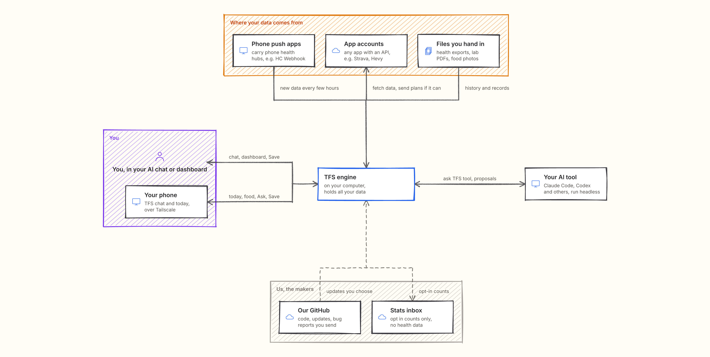
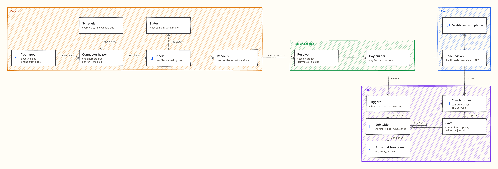
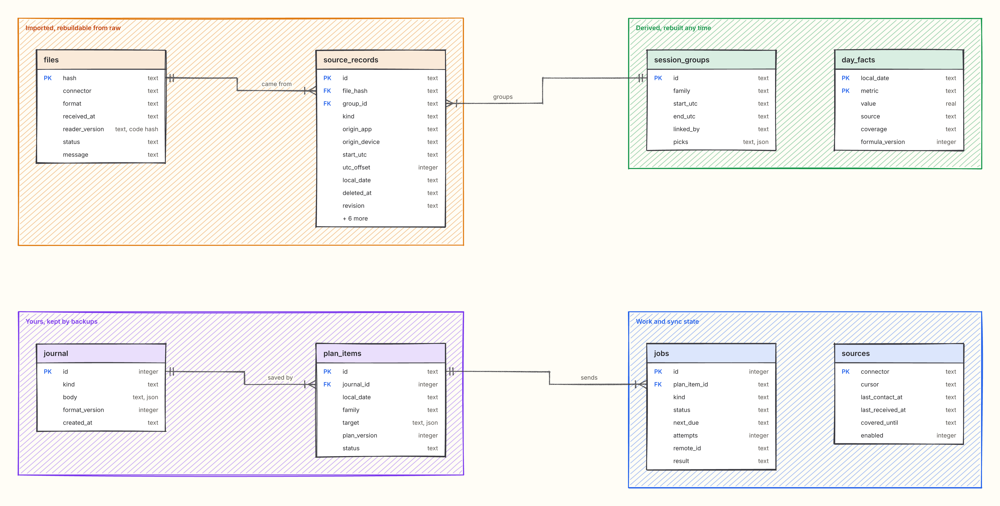
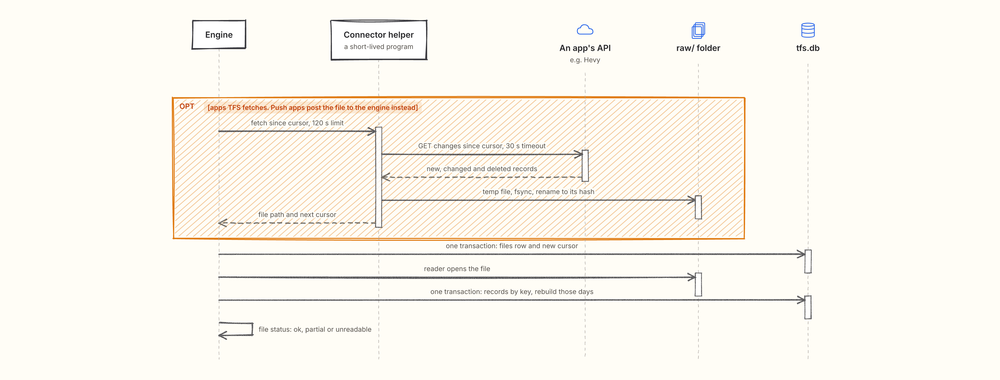
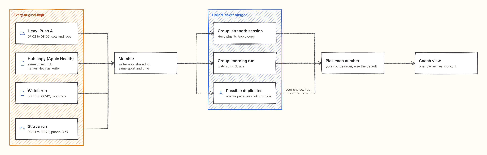
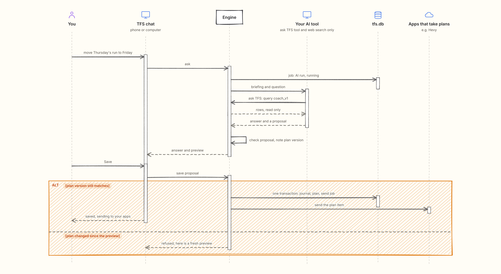
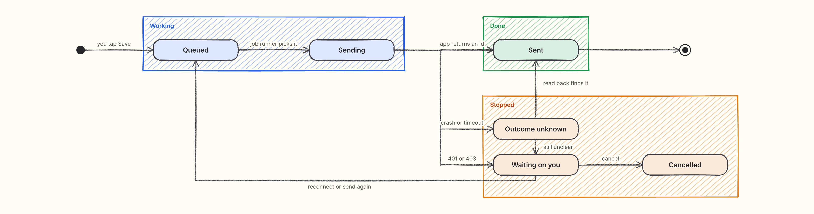
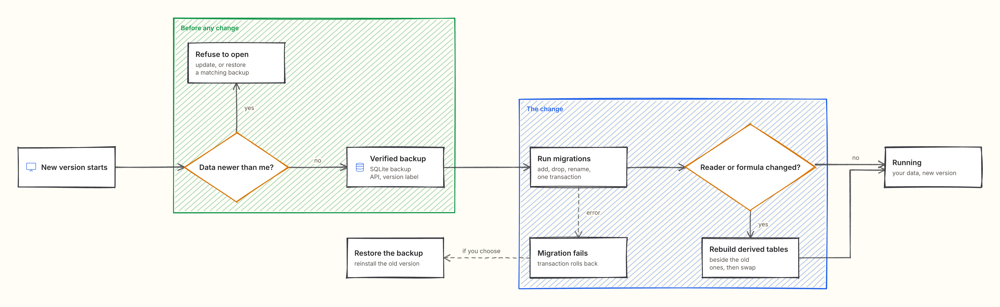

# Training For Something high level design, v2

High level design for Training For Something v1.0.

Durability, data loss, security and correct numbers remain requirements. Pattern names help readers find further details. Each diagram has a JSON source and a PNG image in `diagrams/`.

## 1. Overview

TFS is a free, open source coach for one person's goal. A small engine runs on their computer. It reads data from their health and training apps, keeps each file unchanged, and builds numbers that they can trust.

The AI tool they already pay for reads those numbers, answers questions and proposes changes. Nothing changes until the person approves it. Apps that accept data get the approved plan, for example Hevy and Garmin.

People use the same engine through two interfaces.

1. Their own AI chat, for example Claude Code or Codex, through a TFS plugin.
2. TFS screens on the computer and phone, where TFS runs their AI tool in the background.

Plain code stores data, counts each workout once, builds scores and enforces approvals. The AI explains, plans and suggests.

Each connector holds all code specific to its app. Connectors return results in one standard shape. The engine never branches on an app's name. A new connector can add reading, writing or both without an engine change. Named apps in this document are examples.



## 2. Requirements

### 2.1 What v1.0 promises

v1.0 includes every feature that the website says works.

| Area | Promise |
|---|---|
| Goals and plans | A goal, a date and a target give a plan from research. Six goals at launch, any sport or goal without new code. A forecast range. A missed session rewrites the week. A session shows done when the workout arrives. |
| Coach | Answers from training, sleep, food and records. Live research that prefers reviews of many studies, every source linked and labelled by type. Suggests, says why, changes nothing until you say yes. The same coach in your own AI chat and in TFS's phone and computer screens. |
| Dashboard and phone | Readiness against your own normal. Today's plan, coach, food and notes on the phone over Tailscale while the computer is on. |
| Food and records | Food from a sentence or a photo, with how sure it is and its sources. Blood tests and medical records. |
| Apps | Any app with a way in for a personal user: an API, a phone push app or an export file. The website names 16, plus anything that syncs to a health hub such as Apple Health or Health Connect. Apps that accept data get the approved plan, for example Hevy and Garmin. |
| Trust | Health data stays on your computer. Export everything. Opt-in usage counts only. Free, open source, one-command install. |

### 2.2 Rules TFS always keeps

1. Nothing in your plan or data changes until you approve it. New data from your own apps is the one exception.
2. Every number appears beside your own normal. Missing data shows as missing, never as zero.
3. Every plan choice and food estimate names its source, or says that it is an estimate.
4. Your health data goes only to your computer, the apps you connect and the AI tool you choose.
5. TFS gives no medical advice, diagnoses, doses or changes to a clinician's targets. Every health answer ends with a short disclaimer. The README and the first onboarding screen state the same.

### 2.3 Engineering targets

| Target | How we prove it |
|---|---|
| No accepted data is lost in the tested crash cases | Crash tests stop the process just before and just after every save point (section 15) |
| The same record is never stored twice | UNIQUE natural keys, plus the import-twice fixture |
| A rebuild from raw gives the same numbers as live processing | One code path. A test compares a clean rebuild with live results. |
| An upgraded database matches a clean rebuild | A test migrates the previous release's database and compares |
| A food Save finishes within 1 second during the largest import, on any machine | A test saves food while a 412 MB Apple export imports, run in CI and on a slow drive |
| A 3 year Apple export imports on an ordinary computer | Measured: 412 MB, 937k records, streamed in 15 s at 172 MB peak memory |

### 2.4 Out of scope for v1.0

v1.0 excludes teams, sharing, coach accounts and cloud sync between computers. It also excludes medical advice and phone use while the computer is off.

A remote MCP endpoint for cloud chat apps such as ChatGPT, Claude and Grok on the phone comes later, as described in section 12. User-written trigger rules and Auto mode also come later, as described in section 10.

## 3. Use cases

TFS handles three kinds of work. Each has its own approval rule.

| Kind | Example | Who acts | Approval |
|---|---|---|---|
| You ask | "Move Thursday's run to Friday" | The AI answers and proposes | You say yes in your AI chat, or tap Save in a TFS screen |
| Data arrives | Last night's sleep comes in | Plain code, no AI | None needed |
| A trigger fires | "A planned session passed with no workout" | The AI runs on the built-in rule | A card waits for you to tap Save |

v1.0 supports these journeys.

1. On the first day, run the installer in a terminal. Pick your AI tools and apps, follow each app's steps, and type your goal or skip it. Pair your phone on home Wi-Fi if you want to view TFS there. Paste the printed message into your AI tool to start your plan.
2. Each morning, new data arrives. Readiness shows against your normal, and the phone shows today's session.
3. Ask a question, read the answer and its sources, then Save or refuse a change. The plan goes to every connected app that accepts plans.
4. To log food, type a sentence or take a photo. Review the estimate and Save it.
5. If an app stops sending, the AI tool runs out or an import fails, the Status screen explains the problem and the next action.

Other journeys include adding a blood test in section 6.5 and rewriting the week after a missed session in section 10. Section 13 covers updates, rollback, moving to a new computer and leaving TFS.

## 4. Architecture



### 4.1 Parts

| Part | Job | Pattern |
|---|---|---|
| Web server | Dashboard, phone screens, the push endpoint for phone apps | |
| Scheduler | A loop every 60 seconds that starts whatever is due | anacron-style catch-up, simplified |
| Connector helper | Runs one connector operation in a short-lived program with a time limit | Bulkhead, without a public plugin protocol |
| Connectors | One Python module per app (`fetch`, `read`, `send`, `connect`) plus a small `manifest.json` | Anti-corruption layer |
| Inbox | Saves raw files by hash and registers them, checks the folder on start | Idempotent receiver |
| Readers | One per file format, versioned. Turn raw files into source records. | Normalizer, tolerant reader |
| Resolver | Session groups, daily totals per metric, deletions, your corrections | Entity resolution, tombstones |
| Day builder | Day facts and scores, the same code for live data and rebuilds | Materialized view |
| Coach views | `coach_v1_*` views, the one read surface for the AI and the dashboard | Command query separation |
| Ask TFS tool | A local MCP server TFS ships. Read actions (describe, query) through one guarded reader, plus propose and save. Used by both front doors. | Tool interface over a read model |
| TFS plugin | One folder for every AI tool: one skill with a reference file for asking, planning and research, plus the ask TFS tool | |
| Coach runner | Runs your AI tool in the background for TFS screens and triggers, with the ask TFS tool plugged in | |
| Save | Checks a proposal and applies it with a journal row in one transaction | Plan then apply |
| Triggers | The built-in missed-session rule, ask only in v1.0 | Event, condition, action |
| Job table | AI runs, trigger runs and sends to apps, with a status each | Transactional outbox, in one table |
| Lifecycle | Migrations, backups, export, delete | Evolutionary database design |
| Status | One function that reports what came in, what is stale and what broke | |

### 4.2 Processes

1. The engine is one Python process. It runs the web server, scheduler and job worker as threads.
2. The engine starts a short-lived Python connector helper for each operation, such as fetching new data. It kills the helper at its deadline. Raw data moves by file path, never through a pipe. A stuck parser, endless loop or crash in compiled code stops only the helper.
3. For TFS screens and triggers, the engine starts the AI tool through its adapter. The adapter connects the ask TFS tool and web search. It switches every other tool off through the AI tool's flags. Claude Code uses `--tools "WebSearch"` with `--strict-mcp-config`, `--mcp-config` and `--allowedTools` set to the ask TFS read tools and `WebSearch`. `--tools ""` would switch web search off too. The process runs in an empty temporary folder. A crash returns an unfinished AI run to the queue.
4. In your own AI chat, your AI tool starts the ask TFS tool through the TFS plugin.
5. Start at login uses the OS mechanism, launchd, Task Scheduler or systemd, with restart on failure. A crashed engine restarts by itself.

### 4.3 Storage

TFS uses one folder in the OS app data location. Sync tools skip this location by default.

```text
TFS/
  raw/<connector>/<format>/<sha256>.<ext>   every file as it arrived
  tfs.db                                     one SQLite file, WAL, synchronous=FULL
  backups/                                   two newest database backups
```

App tokens and API keys live in `.env` in the TFS data folder, as described in section 12.

All writes use short transactions in `tfs.db` with a busy timeout. SQLite allows one writer at a time. Parsing and network calls happen outside transactions.

Imports commit small batches of about 500 rows and run the write log's checkpoints themselves. A Save never does that work. After a file finishes, TFS rebuilds the days that it touches, a month per transaction. Until then, the dashboard and AI see those dates marked "importing, incomplete".

Saves take priority over imports. TFS can store data on any disk, so the Save target cannot depend on disk speed. When a Save arrives, the import pauses before its next batch. It resumes after the Save commits. Save announces its intent before opening tfs.db by holding a shared SQLite read lock on the empty sibling file tfs.db.save-priority. Imports yield before each record batch and monthly rebuild while that lock is held. This coordination file alone uses rollback journal mode; it stores no data and process exit releases its locks. Do not unlink it while TFS processes are running. An already-running batch finishes first. With batching alone, 99% of Saves took under 100 ms, but a rare Save still took about 2 s.

Only one engine runs. It binds its fixed port before starting other work. On Windows, Python's stock server lets a second process bind the same port. TFS sets `allow_reuse_address = os.name != "nt"` to prevent this. A Windows test confirmed that the second bind fails with WinError 10048. If another app holds the port, the message names that problem instead of saying "TFS is already running".

Options considered. Separate connector processes with a versioned JSON Lines protocol and manifests add work before outside connectors exist. In-process connectors with network timeouts cannot stop parser loops or native crashes. A lock file needs stale-lock handling, while the port already identifies a running engine. A priority writer thread remains an option if measured Save latency requires it.

## 5. Data model

### 5.1 The layers

| Layer | Where | Rebuildable? |
|---|---|---|
| Raw files, untouched | `raw/` | It is the source |
| Source records, one per record each app sent | `tfs.db` | Yes, from `raw/` |
| Session groups, day facts, scores | `tfs.db` | Yes, from source records |
| What you made: journal, goals, plans, rules, chat | `tfs.db` | No. Kept by backups. |
| Work and sync state: jobs, cursors, freshness | `tfs.db` | Partly. Send history is kept by backups. |



### 5.2 Record kinds

Four record kinds cover every sport and source without new code.

1. A session is a workout of any sport. Its laps, sets, stations, rounds and splits go in `session_parts`. Common columns hold order, kind, duration, distance, reps, weight and heart rate. `extras_json` holds other fields.
2. A measurement holds one metric at one time or over one interval. Examples include heart rate, HRV, weight, glucose and sleep stage.
3. An event records something that happened, such as an app deletion, menstrual period or medication note.
4. A document holds a lab PDF, medical record or food photo, plus the AI extraction that you approved.

Goals, plans, rules and the journal have their own tables.

### 5.3 Every record says where it came from

Each source record stores its connector, source record id, origin app, origin device, raw file hash, reader version and arrival time. The origin app is the app that wrote the record.

These fields explain duplicates, help diagnose formula changes and trace answers to their sources. They let TFS answer questions such as "Why does TFS say I ran 12.3 km?"

### 5.4 Identity

Each record id is a hash of the connector, stream and natural key. A natural key identifies a record from its source fields. Each reader declares the key for each stream.

A UNIQUE constraint makes importing the same data twice safe. The key uses the app's record id when one exists. Otherwise, the reader builds it from available fields.

| Example stream | Natural key |
|---|---|
| Hevy workout | Hevy's workout id |
| Health Connect record | `metadata.id` |
| Apple XML record (no ids, end time always present) | type, source, start, end and value |
| Health Auto Export metric sample (no end time, no id) | metric name, source and date |

Each key has a test fixture. A key change requires a data migration that preserves corrections and remote links to the same records.

Apps can resend and edit records under the same key. Each record from `read` carries a revision: the app's last-changed time when available, otherwise the time its file arrived. Ties go to the later arrival. When a key already exists, the higher revision replaces it.

Every version stays in `raw/`. Rebuilds read files in arrival order so that live and rebuilt results match. For example, the phone sends today's steps as 2,000 in the morning and 9,000 at night. The later value wins.

Journal rows for corrections, link, unlink and "Use this one" store source record ids. They never store session group ids, because TFS rebuilds groups.

### 5.5 Sports

The engine owns a list of about 12 sport families. These are run, ride, swim, strength, row, walk and hike, ski, racket, combat, climb, mixed, and mobility.

Each record keeps the app's label as text. Each connector's reader maps its app's labels to a family. An unknown label keeps no family. It counts toward total load and toward no goal.

Release checks compare vendor sport lists and update readers. A reader's code hash changes after an update, so the engine rereads that connector's raw files.

### 5.6 Time

Each record stores its UTC instant, UTC offset and local date.

1. If the record has an offset, the reader returns it. That offset sets the local date. Apple Health and Health Connect provide examples.
2. If the record has UTC only, the reader returns a null offset. The engine converts each instant with the computer's time zone rules through Python's `astimezone()`. This applies daylight saving for each date and keeps history imports on the right local day. Hevy provides an example.
3. Sleep belongs to the day you wake up. A sleep record counts toward the local date of its end time plus 6 hours, so sleep that starts before midnight joins the night it belongs to. A nap that ends after 18:00 counts toward the next day.

UTC-only sources have known gaps. These include workouts logged while traveling, computers set to another time zone, and rebuilds on a computer in another zone.

Options considered. A `tzdata` package and home zone setting add more than the data needs. Dense packed daily samples are unnecessary because plain rows handle 937k records. A generic key-value table makes queries and tests harder than one parts table with `extras_json`.

## 6. Data in



### 6.1 The connector contract

Each connector holds all code specific to its app. Its folder name is its id.

```text
connectors/hevy/
  connector.py     fetch(), read(), send(), connect()
  manifest.json    what the engine needs before running any connector code
tests/fixtures/hevy/   invented files shaped like the app's real ones
```

The manifest holds what the engine needs before running connector code. It defines the connect screen, fetch timing, and routing for pushes and dropped files. The engine reads the JSON without importing connector code.

This example uses unchecked Hevy values.

```json
{
  "label": "Hevy",
  "about": "Reads your workouts with your Hevy API key. Hevy can change its API at any time.",
  "routes": {"fetch": true, "push": false, "files": []},
  "asks": [{"key": "api_key", "label": "API key", "secret": true}],
  "stale_after_hours": 168,
  "app_ids": ["com.hevyapp.hevy"],
  "notices_deletes": true,
  "sends": ["strength"]
}
```

| Field | Used by |
|---|---|
| `label`, `about` | The connect screen: the app's name, and how it connects, what the user needs and that it can break |
| `routes` | The scheduler (fetch), the push endpoint (push), and dropped-file routing (file name patterns). Two matches for one file means the screen asks you. |
| `asks` | The fields the connect screen shows, each with a label and whether it is secret |
| `stale_after_hours` | How long without a successful contact before the source shows as stale (section 14) |
| `app_ids` | How other apps name this one, so a hub's copy is recognised (section 7.1) |
| `notices_deletes` | When false, the screen says "Deletes in this app do not reach TFS. Hide a record yourself." |
| `sends` | The sport families this app takes, so Save only sends a run to an app that takes runs |

The connector returns everything else in one standard shape.

| Function | Engine passes | Connector returns |
|---|---|---|
| `fetch` | The cursor (the connector's own JSON) and secrets | Raw file paths with their format, the next cursor, and optionally `auth_failed` or `wait_until` |
| `read` | One path and its format | Records, each with kind, stream, key, start in UTC, UTC offset or null, the app's label, family or null, values with units, origin app, origin device and plan reference. Plus `deleted` and `complete_list` records (section 7.4). |
| `send` | The approved item, a stable `op_id` (the job id), the stored remote id and version, and `in_doubt` | One of five outcomes (section 11) |
| `connect` (optional) | What the user typed | Secrets to store, or a URL to open |

The engine calls these functions through the connector helper with a deadline. Each network call also has its own timeout. `auth_failed` stops retries and shows Reconnect on the Status screen.

A reader version is a hash of the connector's code. When it changes, the engine rereads that connector's raw files. Natural keys make this safe.

Every connector must pass the same five contract tests.

1. Reading each fixture twice gives the same keys.
2. Killing a send midway, then retrying with `in_doubt`, never creates a second remote object.
3. A fixture with a failed second page produces no `complete_list`.
4. A 401 or 403 returns `auth_failed`.
5. The manifest matches the code. `sends` needs `send`, `routes.fetch` needs `fetch`, and `notices_deletes` needs a delete fixture.

### 6.2 Routes

| Route | How data arrives | Examples |
|---|---|---|
| Fetch | The scheduler asks the app's API on an interval. The cursor moves only after the raw file is saved. | Strava, Hevy, Oura |
| Phone push | A phone app posts JSON to the engine with a token in a header. Setup starts on home Wi-Fi. You can add Tailscale to send data away from home. | Health Auto Export for Apple Health, HC Webhook for Health Connect |
| File | You hand a file in from the dashboard or phone | A full health export, lab PDFs, food photos |

Each connector screen explains its connection route, requirements and risk of failure. It also lists needs specific to the app. For example, Strava requires the user's own API app and a paid subscription.

An app counts as supported when a route exists for a user who meets its requirements. TFS reads Garmin data with a Garmin Connect Personal API key.

Fitbit data arrives through the phone's health hub. On iPhone, the Google Health app (version 5.05 or later) writes Fitbit data to Apple Health. On Android, it syncs to Health Connect. Google ends the Fitbit Web API on 30 October 2026, and its replacement is closed to new projects, so TFS reads no Fitbit API.

The push endpoint accepts bodies above 100 MB and streams them to a temporary file. One real phone payload measured 22 MB.

### 6.3 Saving a file

1. Write the bytes to a temporary file, flush it and call `fsync`.
2. Rename it to `raw/<connector>/<format>/<sha256>.<ext>`. Identical bytes use the same name, so a resend overwrites itself.
3. Insert the `files` row and the source's new cursor in one transaction.
4. Only after that transaction, return 200 from the push endpoint or mark the fetch complete.

On startup, the engine compares `raw/` with the `files` table. It registers and processes files saved just before a crash. The folder path identifies the connector and format. If a row has no file, the Status screen shows missing evidence.

### 6.4 Reading a file

The reader turns a file into source records and inserts them by natural key. Repeated records add nothing. Readers read units from the data, such as kJ or kcal and kg, lb or st, and convert them. They ignore fields that TFS does not use.

An unknown change or delete event type raises an error. Skipping it risks hiding a deletion.

Each file gets one status.

| Status | Meaning | What happens |
|---|---|---|
| ok | Every record read | Nothing |
| partial | Some records or types rejected | The message names them. The coach sees that coverage is incomplete. |
| unreadable | The file is broken or the format is unknown | Kept. Reread when a new reader version ships. |
| needs your AI | A document only an AI can read | The AI extracts it as a proposal you check |

TFS never retries a broken file with the same reader. The same bytes give the same result. It retries temporary failures, such as locked files or network drops.

### 6.5 Documents and food

Lab PDFs and medical records arrive as files with the status "needs your AI". When you ask, the AI reads the file and proposes values with their page numbers. You review them and tap Save.

Food follows this procedure.

1. Type a sentence or take a photo.
2. The phone shrinks the photo before upload. Re-encoding removes location data in the same step.
3. The AI names each food, estimates the portion, states its confidence and gives its sources.
4. Review the estimate and tap Save.

Photo input through each AI tool remains unproven until its proof test passes.

### 6.6 Big imports

Readers stream large files instead of loading them whole. Apple's XML export uses Python's built-in `iterparse`. A 3 year export took 15 s and 172 MB of memory.

If the disk fills, SQLite rolls back the batch and the cursor stays unchanged.

Options considered. A quarantine table with five error classes and a retry budget adds no value for deterministic parser failures. Omitting the startup scan assumes that apps will fetch orphan files again. That assumption fails for phone pushes and uploaded files.

## 7. Truth

### 7.1 The same workout from two sources



TFS keeps every original record. It links records for the same workout into a session group. The coach view shows one row per group.

A hub collects records from other apps. Apple Health, Health Connect and Samsung Health are examples. A direct source is an app that TFS reads itself. The same workout can arrive through a hub and a direct source, or through two direct sources.

The matcher applies these five rules in order. Only rule 5 needs no source identifiers or metadata, so it works with or without a hub.

1. For the same source and key, the UNIQUE constraint already handles the duplicate.
2. If a hub's origin app matches a connected connector's `app_ids`, its record becomes a candidate copy of that connector's session. TFS links the records only when their times also agree. If the direct record is missing, the hub copy remains the only record. A Hevy workout in Apple Health carries `com.hevyapp.hevy`. Health Connect carries `metadata.data_origin`.
3. If a hub has a history export and live sync, the export covers days before the first synced day. Sync covers days after it. TFS checks coverage on the boundary day so that a partial first day loses nothing. Apple's export and Health Auto Export provide an example. Whether rule 5 and the one-source rule in section 7.3 already cover this remains open. A test with a full Apple export decides before the low level design, especially for daily step totals on the boundary day.
4. If two sources carry the same external session id, TFS links them.
5. Sessions from any sources link when they share a sport family and closely agree on start, end and duration. Distance and device add evidence. Labeled real data determines the thresholds. There is no fixed universal number.

Unsure pairs stay separate and appear on the "Possible duplicates" screen. Your link or unlink goes in the journal and survives every rebuild.

### 7.2 Which number shows

You set source priority for each data type in Settings, then Sources. This follows iPhone Health's Data Sources & Access screen and Health Connect's app priority.

```text
Heart rate          Distance           Steps
  1. Polar strap      1. Apple Watch     1. Apple Watch
  2. Apple Watch      2. Strava          2. iPhone
  3. Strava
```

When sources in a group disagree, the higher source wins. "Use this one" overrides the list for one workout. Both choices live in the journal and survive rebuilds.

Before you set an order, TFS uses these defaults without app-specific knowledge.

1. An original recording wins over a hub copy.
2. A source with the field wins over one without it. Only a strength app has sets.
3. More detail wins over less detail. A full stream wins over an average.
4. Otherwise, the first record to arrive wins.

A new app joins the bottom of each list. Code selects sources because this runs unattended and must be exact. The coach can suggest an order, such as "Your strap is more accurate for heart rate. Move it to the top?" You tap Save to apply it.

Distance, duration and pace always come from one source. This keeps pace from mixing definitions. The group stores its selections. The coach view shows each chosen value and its source. It adds a conflict flag when sources disagree by more than a small margin.

### 7.3 Daily totals

Each day and summed metric counts every moment once. Adding steps or energy across devices or apps risks counting them twice.

Here, a source means one connector stream from one device.

1. Within one connector, merge devices by time. The device with the largest total counts in full. Each other device adds only the time the devices before it did not cover. This is how the phone's own health hub builds its totals. When records carry no time interval, use the largest device total instead.
2. Across connectors, use one connector per day: the first in your priority list with data that day. Before you set a list, a total the reader marks as merged wins, such as Health Auto Export's phone-and-watch total or a Health Connect aggregate. Otherwise, the largest total wins.
3. Store the chosen sources and the coverage beside each total. A day is partial when the chosen connector's last file arrived before that day ended.

### 7.4 Deletions and corrections

The connector's reader turns app deletions into two record types. The engine handles each type without app-specific rules.

A tombstone marks a record as deleted. It hides the record in every view while keeping the raw file.

| Record from the reader | Engine does | Example |
|---|---|---|
| `deleted` (stream, key) | Tombstones that record | Hevy's delete events, HC Webhook's deleted list |
| `complete_list` (stream, window, keys) | Tombstones every record in that stream and window that arrived before the list and is not on it | Strava's activity list for the last 30 days |

The connector marks a list complete only after every page arrives. TFS never infers a deletion from one missing page. An app that reports neither record type has `notices_deletes: false`. Its record stays until you hide it. Reading an older file later cannot restore a newer deleted record.

Your corrections, such as "this was a hike, not a run", live in the journal. The resolver applies them after the readers on every rebuild.

Options considered. General probabilistic matching with selection rules for every field adds more machinery than one person's data needs. Trusting the writer app alone identifies who wrote a record, without identifying its matching session. Many sources also lack that field. Selecting one whole-session winner loses the best fields from other sources.

## 8. Scores

`rebuild_pending()` builds day facts for the dates in `rebuild_dates`, one month of dates per transaction, then rebuilds every score once in its own transaction. Live imports and full rebuilds call the same function, after the records commit. The dates waiting for a rebuild are saved in the same transaction as their records, so a crash cannot skip their day facts. Separate code paths produced different live and replay numbers in testing.

1. Day facts hold one row per day per metric, with source, coverage and formula version.
2. TFS recomputes scores from day facts each time. A test dataset covers about 1,200 days. Scores include readiness from HRV, resting heart rate and sleep against your normal, plus training load, recovery and forecast ranges.
3. Each score stores its formula version. A formula change recomputes all scores.
4. A day with no data or a stale source gives an unknown score, never zero. Metrics marked `zero_is_missing` treat a device value of 0 as missing. A missed session remains "unknown" while its workout source is stale.
5. Baselines use one source per metric. A new device starts a new baseline.

Readiness shows your value against your normal band. Measured variance was too high to present it as a percentile.

The metrics spec defines VO2 max and its source.

## 9. Coach



### 9.1 Two interfaces

```text
   Your own AI chat                      TFS screens
   (Claude Code, Codex...)               (dashboard, phone chat)
          |                                      |
   TFS plugin: skill says               TFS runs your AI tool
   "health questions: use TFS"          in the background
          |                                      |
          +------------>  ask TFS tool  <--------+
                          (read, propose, save)
                                 |
                          guarded reader
                                 |
                       coach_v1 views in tfs.db
```

The engine runs in both cases. It imports data, builds numbers, and runs the phone screens and triggers.

### 9.2 How the AI reads your data

The AI reads data through the ask TFS tool. It never opens `tfs.db` or `raw/` through this route. The tool is a small local MCP server that TFS ships, built on the official MCP Python SDK.

The `describe` action returns views, columns, units and row meanings. The `query` action runs one SELECT over the views. Both use one guarded reader with three controls.

1. A read-only connection uses `mode=ro`.
2. An authorizer refuses reads outside a `coach_v1` view. SQLite applies it to every query.
3. Every query has time, row and byte limits. A clipped result says so.

The views show linked duplicates once and use human units such as km. Each value carries its source and a conflict flag. The dashboard reads the same views, so it shows the same numbers as the AI.

The views keep their columns when underlying tables change. A breaking change adds `coach_v2_*` beside `coach_v1_*`.

Every run that TFS starts begins with a short briefing. It includes the goal, limits, this week's plan, unsaved suggestions and recent chat. The AI uses `query` for anything else.

AI tools use `query` through MCP. The CLI includes `tfs update` to install a release and `tfs phones forget` to remove access for all paired phones.

TFS passes imported text and web pages to the AI as data. They carry no instruction authority.

### 9.3 What the AI can do

The AI answers questions and proposes changes. A proposal is structured JSON with the change, reason and sources. TFS checks it, refuses unknown actions, and records the plan version and state that it used.

In your own AI chat, the AI calls the ask TFS save action. Your AI tool's permission prompt shows the exact change. Your approval saves it. Setting that action to "always allow" skips the prompt.

In a TFS screen, you review the preview and tap Save.

Save applies the change and writes a journal row in one transaction. To take a change back, the AI proposes the opposite change, such as `remove_session` or `move_session` back, and you approve it like any change. If the plan or a required constraint changed after the proposal, Save refuses it and shows a fresh proposal.

### 9.4 How the coach researches

The TFS plugin provides a research method.

1. Prefer meta-analyses and systematic reviews, then trials, then single studies.
2. Find several sources for a claim. State when only one supports it.
3. Use YouTube and athletes' stories to show how people built their plans. Label these sources as anecdote.
4. Label each source by type beside its link.

TFS starts runs with web search enabled beside the ask TFS tool. A tool without web search labels its answer "no live sources". TFS makes sure that each cited link opens before showing it and marks dead links.

The coach looks for odd values, such as zeros and workouts under a minute or over 12 hours. It proposes fixes through `correct_record`. There is no separate flag system. Code builds dashboard numbers, so an odd value counts until corrected. A 3 year Apple Health export held 4 such workouts.

The coach answers health questions using research, your data and your country's health services. Every health answer ends with a short disclaimer. It states that the answer is not medical advice and directs you to a doctor or physio. When a message suggests an emergency, such as chest pain, fainting, an extreme reading or talk of self-harm, the coach tells you to call your local emergency number and to stop training until a doctor has checked you. It proposes no plan changes in that reply.

### 9.5 Running the AI tool

1. For TFS screens and triggers, the engine starts your tool through its adapter with the briefing and question, as described in section 4.2.
2. Each run has a job row. The answer survives closing the phone app, and TFS stores the visible turns.
3. Each adapter distinguishes usage limits, missing login, missing command, bad output and timeout. Each error gets a plain message with secrets and paths removed.
4. When a tool reaches its limit, TFS asks to use the next tool in your order. For example, "Fall back to Codex?" offers Yes, No, Always and Never. "Always" covers only that pair for coaching, such as Claude to Codex. It gives no permission to send data to other models. The fallback tool gets your goals, constraints, accepted plan, pending proposals and recent turns.
5. Background runs pause for a tool already known to be out of usage.

Options considered. Direct AI access to `raw/` or `tfs.db` bypasses the clean views, and database access needs a shell. CSV copies become stale. A fixed data pack cannot reach older history. Restarting the AI with requested data works with every tool, but only for TFS screens, and costs one run per round. Using `tfs query` as the main route requires shell access, which also exposes `raw/`. A vetted study list cannot cover every sport. A quota state machine and circuit breaker per provider duplicate limits that the tools already report.

## 10. Agent triggers

v1.0 has one trigger. It proposes changes and waits for approval.

TFS code creates the missed-session rule with every plan. When a planned session passes without a matching workout, the coach reviews the rest of the week and proposes changes. A card waits for you to tap Save. This fulfills the website promise.

1. The rule fires 12 hours after the planned day ends. This gives late workout syncs time to arrive.
2. If the workout source is stale, or a workout with no sport family arrived that day, the session remains "unknown".
3. You can mark a session done by hand when no app records it.

A per-hour run cap persists across restarts.

Each rule stores `next_due` in UTC. If the computer wakes after that time, the rule runs once and moves to the next time after now. Each occurrence has an id made from the rule revision and event. A restart cannot create the same run twice.

Later versions will support rules written in your own words and Auto mode. The AI will fill a typed condition form, and TFS code will check it. Auto mode first needs a permission design that defines what it can change.

Options considered. User-written rules and Auto mode add features that the website does not promise for v1.0. Auto also needs its own permission design. Asking the AI to write a missed-session rule into every plan cannot guarantee that the rule exists.

## 11. Plans out



An approved plan item goes to every connected app whose manifest includes its sport family in `sends`. For example, strength sessions go to Hevy. The Save preview names the target apps.

Each connector handles its app's send behavior. Some apps ignore repeated requests, some let TFS list what it wrote, and some allow deletion. The connector returns one of five outcomes.

| Outcome | Engine does |
|---|---|
| `sent`, with remote id and version | Marks the job sent and stores both |
| `not_sent` | Retries on the next run. Returned only when the connector knows nothing reached the app. |
| `unknown` | Asks you |
| `conflict` | The app's copy changed since TFS last saw it. Asks you. |
| `needs_you`, with a message | Shows it as a to-do, for example "Delete Tuesday's routine in Hevy" |

After a crash, a job left `sending` always returns through `send` with `in_doubt` set. The connector checks the app before acting. For example, it reads the app's list for its `op_id` marker. TFS never retries `unknown` by itself.

v1.0 implements safe behavior within each connector. It never repeats a send by itself. It reads back where the app allows it, checks for edits before updates, and returns `needs_you` when the app cannot delete. Support for safe resends or deletion starts with the first connector whose app provides that ability.

Hevy has no idempotency key, no delete and whole-object updates. Read back is expected through its routine list. Hevy writes remain untested until their proof test passes.

1. Save applies the plan change, writes the journal row and creates one send job per target app in one transaction. Each job stores the exact approved payload.
2. TFS marks the job `sending` before the request, then records the outcome.
3. A 401 or 403 returns `auth_failed` and waits for you to reconnect.
4. A session shows done when an arriving workout matches its plan reference to the remote id returned by `send`. The reader sets that reference, for example from Hevy's `routine_id`. Otherwise, TFS matches by date and family. If two planned sessions in one family share a day, the nearest start time wins. Sending a plan never marks training done.

Options considered. Manifest write-safety flags with engine branches move app knowledge into the engine. Many apps cannot honor idempotency keys. A separate outbox ledger duplicates the job table.

## 12. Phone and security

The engine binds to 127.0.0.1. Tailscale Serve exposes it through HTTPS inside your private tailnet, the devices on your Tailscale network. It never exposes the engine to the public internet. The phone gets the same TFS chat, today's plan, food and notes. The computer must be on.

Terminal setup starts on home Wi-Fi. You can add Tailscale for use away from home.

| Route | How | Works |
|---|---|---|
| Home Wi-Fi (default) | Apps send pushes with a token. Only phones that scanned the pairing code can open the dashboard. During setup, a one-time link opens the phone setup page. | When the phone is on the same network |
| Tailscale | Phones open the dashboard and apps send pushes through Tailscale Serve. | Away from home, while Tailscale is connected |
| Both | Push apps use whichever is reachable | Most of the time |

Push apps resend recent days. Data sent at home fills gaps from time away.

Away from home, Tailscale handles sign-in: only devices on your tailnet can reach the computer. The engine refuses any request whose Host header is not the computer's own name. This blocks DNS rebinding, where a web page in your browser points a name at the engine.

| Request | How it proves itself |
|---|---|
| Browser on the computer or phone | The computer uses its local listener. A phone uses its pairing cookie on home Wi-Fi or connects through the private tailnet. |
| Phone push app | A token in a header. It can only send data in. |

Uvicorn parses each request, and FastAPI routes it. TFS adds checks for Host, Origin, request size and a body that stops arriving. Pages escape displayed content. The engine closes the connection on any refused push.

App tokens and API keys live in one `.env` file in the TFS data folder. Only the user can read it. Backups and exports leave it out.

Secrets never enter `raw/`, chat, logs, exports or backups. Moving to a new computer requires reconnecting accounts.

The AI tool is trusted software with your access rights. The documentation states this. For runs that TFS starts, TFS limits the tool through its flags and provides the ask TFS tool.

Some AI tools cannot disable their shell. Codex keeps one in read-only mode, so it can read files directly. The views provide accurate data. AI actions cannot save changes without your approval.

You can also add the ask TFS server by hand to desktop chat apps such as Claude Desktop or LM Studio. A remote MCP endpoint for ChatGPT, Claude and Grok on the phone waits until a real need justifies public access. It requires a maintained OAuth component. TFS will not implement OAuth itself.

Options considered. A public tunnel with OAuth for 1.0 exposes health data before solving background coaching. Tailscale-only phone data requires people to keep a VPN on. An OS password store adds a package and three platform paths to guard two low-value keys that the user can reset.

## 13. Lifecycle

### 13.1 Install and onboarding

1. Run the install command in a terminal. It installs TFS with uv and starts setup.
2. Pick your AI tools, then pick your apps. Follow the steps for each app you picked.
3. Type your goal once or press Enter to skip. Setup uses what you type in the first chat message. It does not save the goal.
4. To view TFS on your phone, scan the pairing code on home Wi-Fi. You can add Tailscale for use away from home. Paste the printed message into your AI tool.

### 13.2 Upgrades



1. The new version reads `PRAGMA user_version`. If the data is newer than it understands, it refuses to open and explains recovery.
2. Before changing an existing database's schema, TFS backs it up.
3. It runs numbered migration scripts in one transaction. A migration can add, drop, rename or rebuild a table using SQLite's documented 12-step method. Two-release expand and contract applies only when something outside TFS reads the old shape, such as `coach_v1`.
4. If a reader or formula version changed, TFS rebuilds derived tables beside the old tables inside `tfs.db`. It checks the results, then swaps the tables in one transaction.

Release notes start with "Breaking changes". Each entry states the change and its replacement. Changes to `coach_v1` views and the ask TFS tool come first because AI plugins depend on them.

Rollback restores the pre-upgrade backup and reinstalls the old version with uv. The restore screen first warns that this loses saves made after the upgrade. Outbound sends pause during restoration until TFS reconciles job history with each target app.

### 13.3 Backups

Before changing the schema of an existing `tfs.db`, TFS copies the database to `backups/` in the data folder. It keeps the two newest copies.

### 13.4 New computer

1. Install TFS.
2. Select a backup.
3. Reconnect your accounts.

The backup restores data and history. It excludes secrets.

### 13.5 Leave

Export everything writes raw files, a manifest and JSON for every user-created table. These tables include the journal, goals, plans, rules and chat.

Delete my data removes the data folder, including `.env`. The confirmation screen lists the exact paths first. It also explains that external copies remain in your apps, backups and AI tool's history.

### 13.6 Telemetry and bug reports

Telemetry stays off unless you enable it. Once enabled, TFS automatically sends a fixed set of counts. These include app version, platform, feature used, job kind and error code.

Telemetry sends no free text, prompts, titles, values, paths or tokens. The inbox drops IP addresses. PostHog hosts the inbox. Its public project key can send events and read nothing. PostHog's setting that discards IP addresses stays on. Anyone can send fake counts, so the numbers are treated as rough. The website's "no servers of ours" statement must name this opt-in statistics inbox.

Bug reports use a separate flow. A button shows the exact report text first. After review, it opens a prefilled GitHub issue. This flow uses no TFS server and requires a GitHub account.

Options considered. A new database generation and pointer switch for each upgrade doubles disk use and loses actions after the switch. Additive-only migrations with rollback by reinstall let old code misread new data. Separate truth and derived SQLite files lose atomic WAL transactions across those files.

## 14. Operations

One status function supplies the Status screen, Today card and `tfs status`.

| It shows | Per |
|---|---|
| Last attempt, last file received, data covered until | Source |
| Stale when TFS has had no successful contact within the connector's `stale_after_hours`. An empty fetch counts as contact, so a rest week does not look broken. | Source |
| File states and their messages | File |
| Jobs waiting on you: outcome unknown, reconnect, Ask cards | Job |
| AI tools: signed in, out of usage, missing | Tool |
| Backups: last good one, where | Install |

Status reports include detail such as "Received yesterday, covers three days ago, sleep is incomplete".

The "Copy diagnostics" button copies the same report without health values for the bug report flow.

## 15. Testing

Tests use the standard library's `unittest`, plus Hypothesis as a test-only dependency for parsers and scores. Every test file also includes handwritten examples with exact expected values. Tests use an invented person and never real health data.

CI runs on macOS, Windows and Linux with the Python and SQLite versions that TFS ships.

Each connector includes invented fixtures shaped like the app's real files. It must pass the five contract tests in section 6.1.

### Data fixtures

Ten fixtures cover known data failures.

The first group covers imports and record formats.

1. Import twice and rebuild, with unsummarized energy.
2. An Apple and Hevy strength pair.
3. A Hevy delete event.
4. Units, with kJ and kcal, and weight in kg, lb and st.
5. Sleep in both shapes.

The second group covers time, corrections and incomplete data.

1. A Hevy morning session in a fixed `+13:00` zone.
2. A correction that survives a rebuild.
3. An empty newest day that shows waiting.
4. A truncated export marked unreadable.
5. Strava's 30-day reread.

Every connector test checks four rules.

1. A 401 or 403 stops retries.
2. The cursor moves only after TFS saves the raw file.
3. TFS tracks freshness per source.
4. Missing data shows as missing.

### Storage and rebuild tests

1. Crash tests stop the process just before and after each save point. These points are the raw file write, files row commit, records commit and send marker. After restart, tests make sure that nothing is lost or doubled.
2. Live fixture processing must equal a clean rebuild from `raw/`.
3. The previous release's migrated database must equal a clean rebuild.
4. A food Save during the 412 MB import must finish within 1 second.
5. A later, fuller value for the same key must replace the first during live processing and rebuilds.

### Time, access and AI tests

1. A UTC-only history import across a daylight saving change must keep each local date.
2. The guarded reader must refuse or cap base table reads, writes, `ATTACH`, pragmas and huge results through `query`. View reads must pass.
3. Request tests cover bad Host and bad Origin. They also cover oversized bodies and refused pushes.
4. AI adapter tests replay each tool's recorded error outputs. These cover usage limits, signed out, missing tool, bad output and timeout.
5. Before each release, each AI tool answers about 20 questions about the invented person. Proposal JSON must be valid, numbers must match exactly, and every link must open. Health answers must carry the disclaimer. Dose requests must receive no dose. Decoys include instructions injected into a workout title.

Duplicate Save, restored backups and surviving child processes each get one test.

## 16. Open questions

Proof tests check a route on a real device or account before code depends on it. Each one is an issue labelled `proof-test`.

### Specs

[`specs/plan-items.md`](specs/plan-items.md) defines the plan item. [`specs/proposal-actions.md`](specs/proposal-actions.md) defines the closed list of actions. [`specs/metrics.md`](specs/metrics.md) defines metrics and forecasts.

### Unverified facts

1. Several app routes rely on third-party sources.
2. Antigravity's FAQ says that wrapping its CLI in another app is unsupported on consumer plans.
3. Whether Mi Fitness and Zepp write into Health Connect remains unconfirmed.
4. Hyrox and lean physique dashboards have no design yet.
